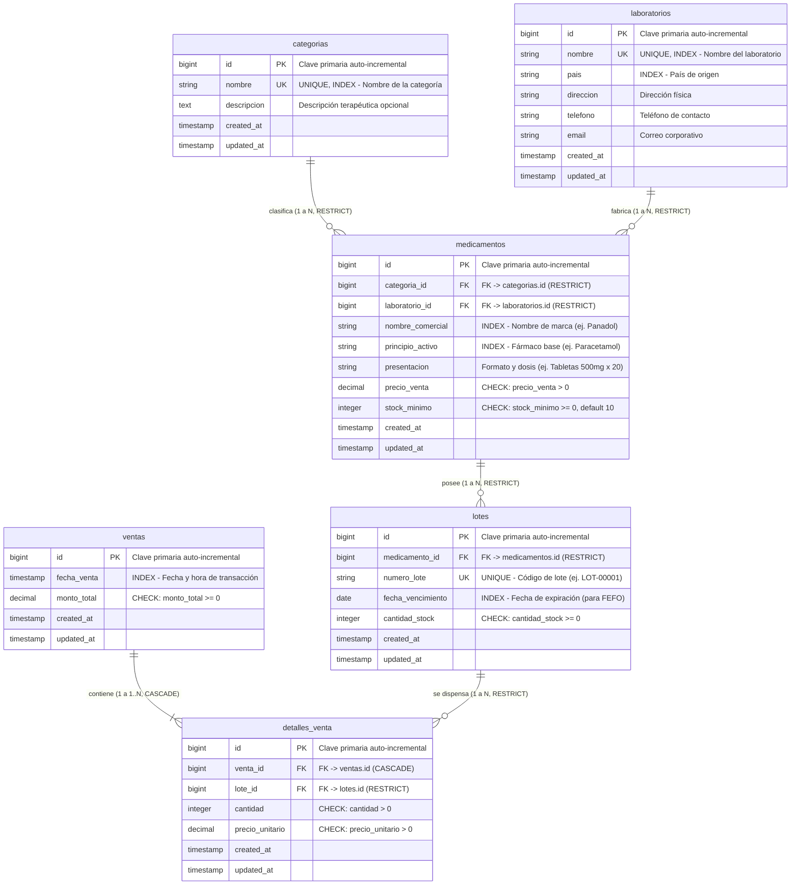

# Diagrama Entidad-Relación — Control de Inventario de Farmacia

Este diagrama representa la estructura de base de datos relacional implementada en PostgreSQL para el sistema de control de inventario de farmacia.

## Diagrama Mermaid

---

## Cómo exportar el Diagrama a imagen PNG (para el Word)

Tienes tres opciones sencillas:

### Opción 1: Mermaid Live Editor (La más rápida y recomendada)
1. Entra a [https://mermaid.live](https://mermaid.live).
2. Copia el bloque de código `erDiagram` de arriba y pégalo en el editor izquierdo.
3. En la parte inferior derecha, haz clic en **Actions** > **Download PNG** (o haz clic en el botón de captura de pantalla).
4. Guarda la imagen y pégala en tu documento Word.

### Opción 2: PlantUML Server
1. Abre el archivo [docs/diagrama_er.puml](file:///c:/laragon/www/Control%20de%20inventario%20de%20una%20farmacia/docs/diagrama_er.puml).
2. Entra a [http://www.plantuml.com/plantuml/uml/](http://www.plantuml.com/plantuml/uml/).
3. Pega el contenido y haz clic en **PNG** para descargar la imagen en alta definición.

### Opción 3: DBeaver / pgAdmin (Directo de tu PostgreSQL)
* En **DBeaver**: Haz clic derecho sobre tu base de datos `farmacia_inventario` > `Ver Diagrama ER` > Clic derecho > `Guardar diagrama como imagen (PNG)`.
* En **pgAdmin 4**: Haz clic derecho sobre `farmacia_inventario` > `Generate ERD` > Clic en el botón de cámara/guardar como imagen.
